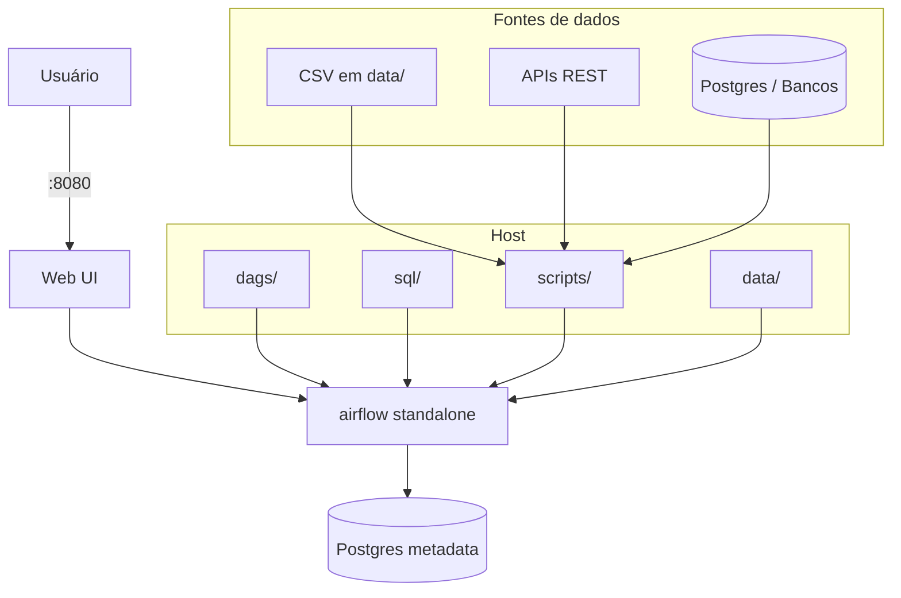

# Template Airflow

Template para projetos Apache Airflow com múltiplos DAGs de migração. Suporta extração de **CSV**, **API** e **banco de dados** (Postgres). Inclui Docker, Postgres para metadados, helpers reutilizáveis e DAGs de exemplo para cada fonte.

## O que é

- **Airflow 2.x** com imagem oficial (`apache/airflow:2.10.4-python3.11`)
- **LocalExecutor** e Postgres dedicado para metadados do Airflow
- **`airflow standalone`** — scheduler e webserver em um único processo (recomendado para dev e prototipagem)
- Suporte multi-fonte: CSV (`scripts.csv_helpers`), API (`scripts.api_helpers`), banco (`scripts.db`, `scripts.etl_helpers`)
- Pastas prontas para DAGs, SQL, scripts Python e dados
- Makefile para subir, derrubar e inicializar o ambiente

## Pré-requisitos

- [Docker](https://docs.docker.com/get-docker/) e [Docker Compose](https://docs.docker.com/compose/install/)
- Make (opcional, mas facilita os comandos)

## Arquitetura (fluxo local)



O `standalone` lê DAGs, SQL e scripts dos volumes montados. O banco da aplicação (se existir) é acessado via variáveis `DB_*`; em Linux, use `host.docker.internal` se o banco estiver na máquina host.

## Estrutura de pastas

| Pasta | Propósito |
|-------|-----------|
| `dags/` | Orquestração — cada arquivo `.py` define uma ou mais DAGs de migração |
| `sql/` | ETL declarativo — um arquivo por operação (extract, transform, load) |
| `scripts/` | Python compartilhado — `db.py`, `etl_helpers.py`, `csv_helpers.py`, `api_helpers.py` |
| `data/` | Staging — CSVs de entrada/saída, arquivos intermediários usados pelas tasks |
| `plugins/` | Extensões do Airflow (operadores, hooks customizados) |

## Fontes de dados suportadas

| Fonte | Módulo | Variáveis de ambiente |
|-------|--------|----------------------|
| **CSV** | `scripts.csv_helpers` | — (arquivos em `data/`) |
| **API REST** | `scripts.api_helpers` | `API_BASE_URL`, `API_TOKEN` (opcional) |
| **Banco (Postgres)** | `scripts.db`, `scripts.etl_helpers` | `DB_HOST`, `DB_USER`, `DB_PASSWORD`, `DB_DATABASE` |

## Primeiro uso

1. Copie este diretório para o seu projeto ou use-o como está.

2. Crie o arquivo de ambiente:
   ```bash
   cp .env.example .env
   ```

3. Preencha `DB_HOST`, `DB_USER`, `DB_PASSWORD` e `DB_DATABASE` no `.env` se suas tasks conectarem a um banco externo. `example_minimal`, `example_csv_dag` e `example_api_dag` funcionam sem banco.

4. Inicialize o ambiente (Postgres + metadados Airflow + usuário admin):
   ```bash
   make init
   ```

5. Suba o Airflow:
   ```bash
   make up
   ```

6. Acesse [http://localhost:8080](http://localhost:8080), faça login com `admin` / `admin` e ative os DAGs de exemplo: `example_minimal`, `example_csv_dag` (CSV), `example_api_dag` (API).

Comandos úteis: `make logs` (ver logs), `make down` (derrubar), `make restart` (reiniciar).

## Como criar um DAG real

1. Crie um arquivo em `dags/` (ex.: `meu_etl_dag.py`).
2. Use `catchup=False` e `max_active_runs=1` para evitar execuções em paralelo indesejadas.
3. Defina um `dag_id` único.
4. Mantenha tasks **idempotentes** — reexecutáveis sem efeitos colaterais.
5. Use os helpers em `scripts/` em vez de código ad hoc: `csv_helpers`, `api_helpers`, `etl_helpers`.
6. Use variáveis de ambiente (`DB_*`, `API_*`) para credenciais, nunca valores hardcoded.
7. Configure `PYTHONPATH=/opt/airflow` (já no docker-compose) para que os imports de `scripts` funcionem nos containers.

**Exemplo — SQL (banco):**
```python
from scripts.etl_helpers import run_sql_file

def extract():
    run_sql_file("01_extract.sql")
```

**Exemplo — CSV:**
```python
from scripts.csv_helpers import load_csv, save_csv

def transform_csv():
    df = load_csv("input/source.csv")
    df = df.drop_duplicates()
    save_csv(df, "output/transformed.csv")
```

**Exemplo — API:**
```python
from scripts.api_helpers import fetch_json_to_csv

def fetch_data():
    fetch_json_to_csv(url="https://api.example.com/data", output_path="api_data.csv")
```

**Exemplo — CSV para banco:**
```python
from scripts.etl_helpers import load_csv_to_db

def load_staging():
    load_csv_to_db("staging/export.csv", "staging_table", schema="public")
```

## Produção vs. local

O modo `standalone` é adequado para desenvolvimento e prototipagem. Em produção:

- Use scheduler, webserver e workers separados ([Production Deployment](https://airflow.apache.org/docs/apache-airflow/stable/production-deployment.html)).
- Considere Celery ou Kubernetes para escalar tasks.
- Configure `AIRFLOW__CORE__FERNET_KEY` com uma chave gerada:
  ```bash
  python -c "from cryptography.fernet import Fernet; print(Fernet.generate_key().decode())"
  ```
- Armazene segredos em backends (Variáveis do Airflow, Vault, etc.), não em `.env` versionado.
- Considere [Airflow Connections](https://airflow.apache.org/docs/apache-airflow/stable/administration-and-deployment/connections.html) para credenciais de banco e API em vez de variáveis `.env`.

## Referências

- [Quick Start](https://airflow.apache.org/docs/apache-airflow/stable/start.html)
- [Docker Compose](https://airflow.apache.org/docs/apache-airflow/stable/howto/docker-compose/index.html)
- [Best Practices](https://airflow.apache.org/docs/apache-airflow/stable/best-practices.html)
